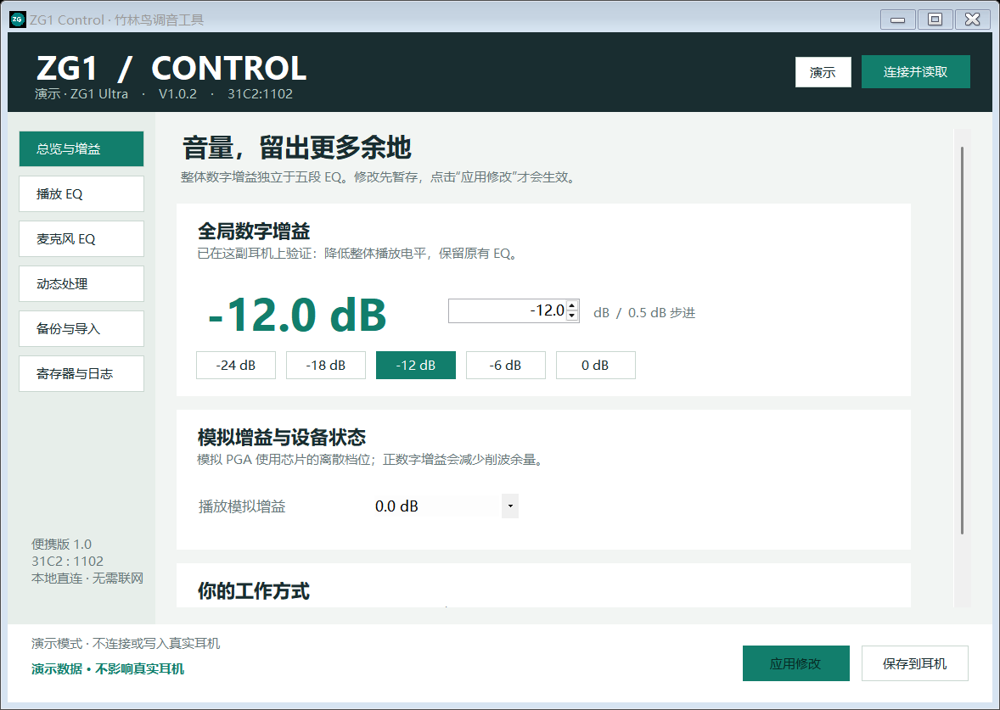
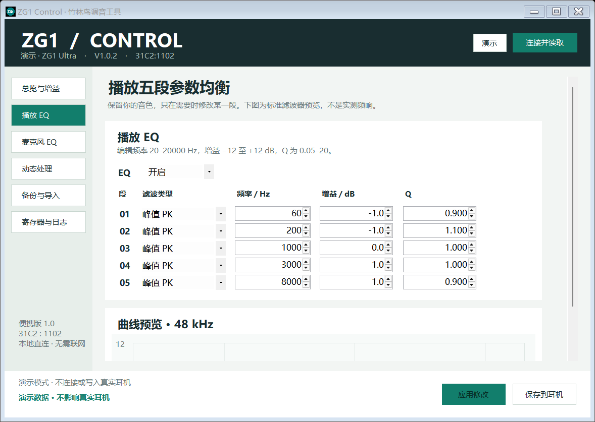
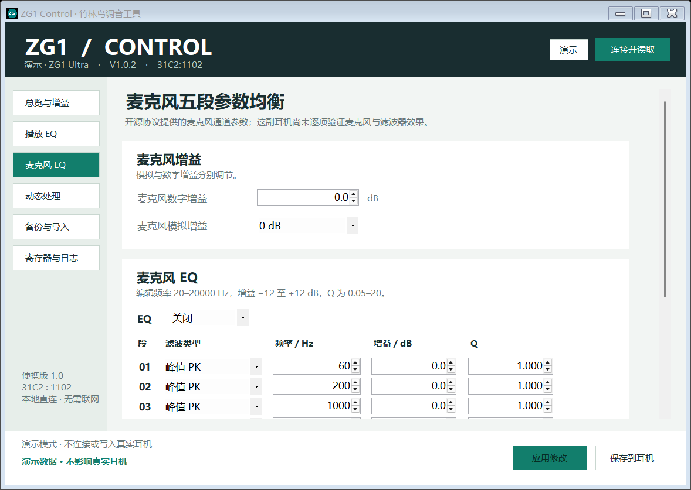
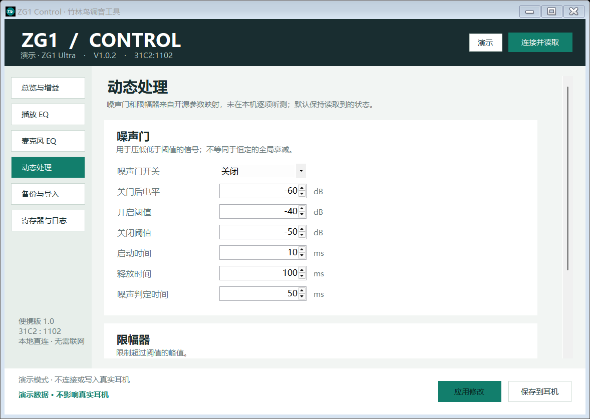
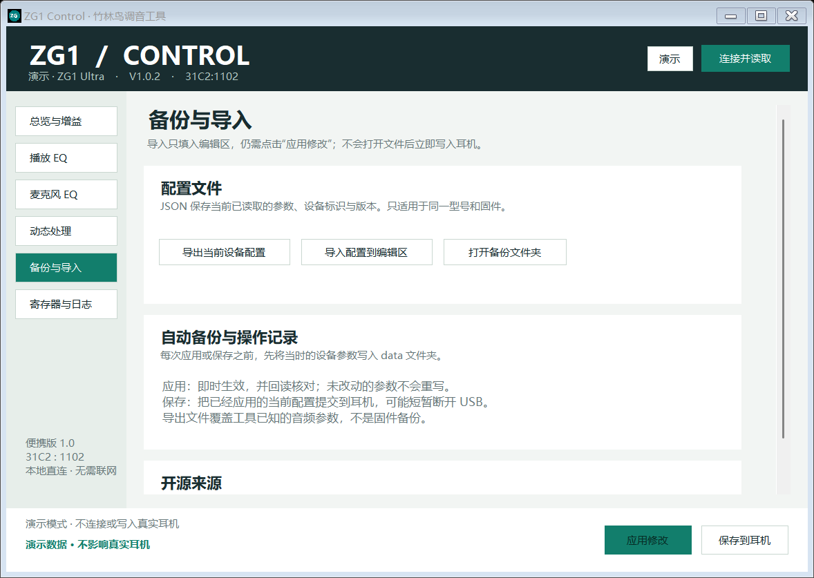
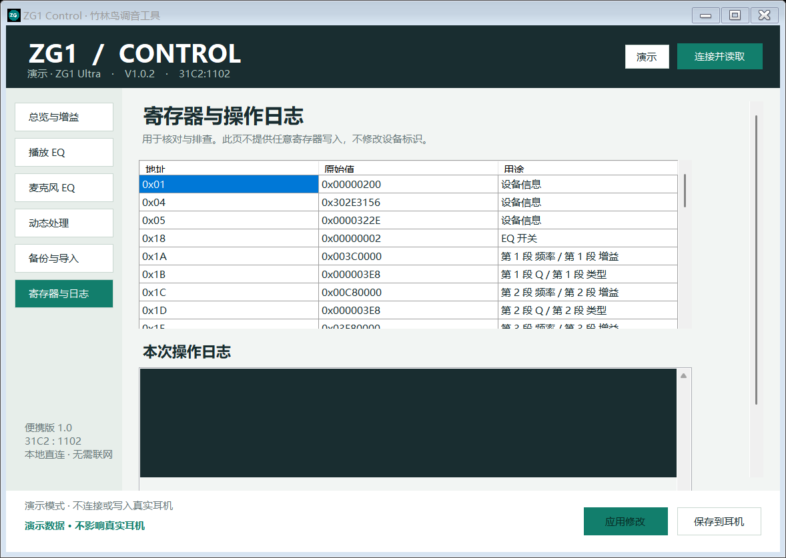

# ZG1 Control

**给竹林鸟 ZG1 Ultra 做的 Windows 便携调音工具。**

把整体音量、五段 EQ 和动态处理放在同一个界面里：先读设备，编辑后应用，再按需保存到耳机。

[](https://github.com/257500691/zg1-control/releases/latest)


**[下载便携版](https://github.com/257500691/zg1-control/releases/latest)** · [快速开始](#快速开始) · [功能与界面](#功能与界面) · [验证范围](#验证范围) · [从源码构建](#从源码构建)



*截图均来自演示模式。界面中的 −12 dB 只是示例；打开程序不会把它自动写入耳机。*

## 为什么做这个工具

这款 Type-C 耳机在 iPhone 和 Windows 上可能出现整体输出偏大的情况：系统音量需要拖到很低，才容易找到合适的听音电平。

把五个 EQ 频段分别拉低，会改变原来的频响，不能代替独立的全局衰减。ZG1 Control 将**全局数字增益**单独放在首页，让你可以保留五段 EQ，只调整整体播放电平。

在用于开发的这副耳机上，已将全局数字增益从 0 dB 设为 −12 dB，保存后换接 iPhone，用户确认音量下降仍然有效。工具不会把这个结果推广为所有硬件和固件都兼容。

> 本项目是基于开源协议的非官方 Windows 适配工具，与竹林鸟、KTMicro 及上游项目没有官方隶属或背书关系。

## 快速开始

### 1. 下载并打开

从 **[Releases](https://github.com/257500691/zg1-control/releases/latest)** 下载 `ZG1-Control-Windows-v1.0.zip`，完整解压到一个可以写入文件的位置，然后双击 `ZG1-Control.exe`。

- 无需安装 Python 或第三方库。
- 使用 Windows 自带的 .NET Framework、HID 和 USB 音频驱动。
- 日常使用不需要联网。
- 想先熟悉界面，可以点右上角的 **演示**；该模式不连接真实耳机。

### 2. 连接并读取

把耳机接到 Windows 电脑，点 **连接并读取**。界面会显示设备当前参数，不会自动套用预设。

### 3. 修改并应用

在界面中编辑所需参数。**此时只修改编辑区，设备还没有变化。**

点 **应用修改** 后，会先展示修改前后的差异清单；确认后，工具自动备份当前状态，只写入需要改变的参数，再回读核对。未改动的参数不会重写。

### 4. 保存到耳机

需要拔插、换设备后保留设置时，点 **保存到耳机**。这一步提交的是已经应用的当前配置，USB 可能短暂重新连接。

保存后拔插一次，再重新读取，可以核对断电后的实际状态。换接手机试听时，从较低系统音量开始。


**只想降低总音量？** 首页只改“全局数字增益”即可，不需要修改五段 EQ、模拟增益或动态处理。快捷按钮也只填入编辑区，不会立即写入。

## 兼容范围

| 项目 | 当前版本 |
|---|---|
| 目标设备 | 竹林鸟 ZG1 Ultra Type-C |
| USB VID / PID | `31C2:1102` |
| 已验证内部版本 | `V1.0.2` |
| 控制接口 | HID `MI_03`，Report `0x4B`，11 字节 |
| 音频接口 | 系统 USB Audio 驱动，保持原驱动 |
| 系统 | Windows；开发和实机检查在 Windows 11 完成 |
| 运行环境 | Windows .NET Framework 与自带系统组件 |
| 写入限制 | 锁定已核对的设备标识、固件和单 DAC 控件模式 |

**相同芯片型号不代表相同控制协议。** 本工具不会自动连接其他 VID/PID 的设备；不应拿它给 JA11 或其他 KT02H20 设备直接写入参数。同 VID/PID 的其他内部版本没有开放写入。

## 功能与界面

共提供 **58 个音频参数控件**，覆盖当前单 DAC 控件模式。

| 页面 | 可调或可查看的内容 |
|---|---|
| 总览与增益 | 全局数字增益、播放模拟 PGA 档位、常用衰减快捷值 |
| 播放 EQ | 五段频率、增益、Q、滤波类型，EQ 开关，曲线预览 |
| 麦克风 EQ | 麦克风数字和模拟增益，五段 EQ 及开关 |
| 动态处理 | 噪声门、限幅器及其阈值、时间参数 |
| 备份与导入 | 导出当前设备配置，导入同型号/固件配置到编辑区 |
| 寄存器与日志 | 已知寄存器的原始值，发送/接收及操作日志 |

### 播放五段 EQ



- 每段可编辑频率、增益和 Q。
- 滤波类型包括峰值 `PK`、低通 `LPF`、高通 `HPF`、低架 `LS`、高架 `HS`。
- 全局增益与 EQ 参数分开：只改全局增益时，不会重写这五段。
- 曲线是标准 RBJ 滤波器在 48 kHz 下的示意，**不是耳机实测频响，也不是固件内部计算结果**。

### 麦克风增益与 EQ



麦克风通道提供独立的数字增益、模拟 PGA 档位和五段 EQ。该部分按上游开源寄存器映射实现，尚未在目标耳机上逐项写入和听测。

### 噪声门与限幅器



| 模块 | 参数 |
|---|---|
| 噪声门 | 开关、关门后电平、开启阈值、关闭阈值、启动时间、释放时间、噪声判定时间 |
| 限幅器 | 开关、软拐点、阈值、启动时间、释放时间 |

动态处理会根据信号电平改变行为，不等同于固定的整体音量衰减。只想降低总音量时，保持这些参数原样即可。

### 配置备份与导入



- **导出**：保存当前已读取的设备配置，不包含尚未应用的编辑。
- **导入**：检查格式、型号、固件和控制模式，然后填入编辑区；不会立即写入设备。
- **自动备份**：每次应用或保存之前，先备份当时的设备参数；备份失败就停止写入。
- 配置快照覆盖工具已知的音频参数，**不是完整固件或整机恢复备份**。

### 寄存器与日志



可以查看已知寄存器、原始数值以及本次收发日志，便于追溯修改。此页不提供任意寄存器写入，也不会修改设备的 VID、PID 或产品标识。

## 参数范围

| 参数 | 界面范围 / 步进 |
|---|---|
| 全局数字增益 | −64 至 +63.5 dB，0.5 dB 步进 |
| 麦克风数字增益 | −64 至 +63.5 dB，0.5 dB 步进 |
| 播放模拟增益 | 静音，以及 −18 至 +3 dB 的离散档位 |
| 麦克风模拟增益 | 0、−6、+8、+14、+20、+26、+32、+44 dB |
| EQ 频率 | 编辑时限制为 20–20000 Hz |
| EQ 增益 | 编辑时限制为 −12 至 +12 dB |
| EQ Q | 编辑时限制为 0.05–20 |
| 动态处理阈值 | 按上游编码显示 −256 至 −1 dB |
| 动态处理时间 | 0–65535 ms |

数字增益的范围来自开源编码定义，**不是对本机全部档位的音频测量或推荐范围**。正增益会减少削波余量。读取到的原始状态会保留，不会在连接时自动“纠正”或重置。

## 验证范围

| 项目 | 状态 |
|---|---|
| HID 描述信息与读取协议 | 已在目标实机验证 |
| 全局数字增益从 0 dB 调为 −12 dB | 已写入、回读，且用户确认 Windows 播放音量即时下降 |
| 保留原有五段 EQ 与其他寄存器字节 | 已逐项核对本次改动前后读数 |
| 配置保存及换接 iPhone | 用户确认换接后衰减仍生效 |
| Windows EXE 读取全部已知参数 | 已在实机只读读取 36 项寄存器 |
| 编码、掩码、备份失败和异常停止等逻辑 | **287 项模拟检查通过** |
| 六个界面页面 | 已在演示模式渲染检查 |
| 模拟 PGA、麦克风参数、各滤波类型、噪声门、限幅器 | 已实现并完成模拟测试，尚未逐项实机写入/听测 |

−12 dB 是协议设定值，未用测量设备核对实际输出电平；内部数字增益位于 EQ 前还是 EQ 后也未测定。更多细节见 [验证记录](docs/validation.md)。

## 备份、日志与异常处理

运行时数据保存在 EXE 同目录：

```text
data/
├─ backups/          # 真实设备修改前的参数备份
├─ demo-backups/     # 演示模式备份
└─ last-session.log  # 最近一次操作日志
```

- 其他调音程序改动过参数后，先重新读取再编辑。本工具会检查设备状态，避免用旧界面覆盖新配置。
- 应用期间 USB 断开或回读不一致时，部分参数可能已经即时生效；工具会停止，且不会继续发送保存指令。
- 如果保存指令已发送、但未能重新读取，不要反复保存；先拔插并重新读取核对。
- 应用或保存前暂停播放；提高增益时从较低系统音量开始试听。

本项目不提供刷固件、任意寄存器写入、设备标识修改或自动更新功能。

## 从源码构建

不需要 NuGet 包或额外依赖。构建脚本调用 Windows .NET Framework 自带的 C# 编译器。

```powershell
git clone https://github.com/257500691/zg1-control.git
cd zg1-control
powershell -NoProfile -File .\source\build.ps1
```

生成的 `ZG1-Control.exe` 位于仓库根目录。若系统策略阻止脚本执行，按本机策略处理，无需为了运行工具关闭安全策略。

### 模拟测试

以下命令只使用内存设备，不访问真实耳机：

```powershell
$test = Start-Process .\ZG1-Control.exe `
  -ArgumentList '--self-test', 'self-test.txt' -Wait -PassThru
Get-Content .\self-test.txt
$test.ExitCode
```

预期结果：`PASS: 287 checks. Simulated device only; no hardware I/O.`

也可以用 `ZG1-Control.exe --demo` 打开演示界面。开发用命令 `--probe` 会读取真实设备；它不是模拟测试，也不会写入参数。

## 仓库结构

```text
zg1-control/
├─ README.md
├─ LICENSE
├─ THIRD_PARTY_NOTICES.md
├─ source/              # 完整 C# 源码、构建脚本、图标与清单
├─ docs/
│  ├─ images/           # 六个页面的演示截图
│  ├─ validation.md     # 验证范围与已知限制
│  └─ 使用说明.txt
└─ licenses/            # 上游许可文本
```

仓库和公开下载包不包含开发者的运行日志、个人备份或真实设备的配置快照。

## 开源来源与许可

本项目采用 **BSD-3-Clause** 许可，保留上游版权与许可声明。参数映射、协议研究主要参考：

- [gxcreator/ktmicro-tools](https://github.com/gxcreator/ktmicro-tools)：KT02H20 寄存器、增益编码、EQ、噪声门和限幅器，BSD-3-Clause。
- [jeromeof/devicePEQ](https://github.com/jeromeof/devicePEQ)：KTMicro 的 `0x53` 配置提交帧，随仓库附上游许可文本。

ZG1 Control 增加了 Windows 原生 HID 适配、中文图形界面、局部参数写入、保留位处理、变更预览、自动备份与回读检查。上游项目和作者并未对本工具作出兼容保证或背书。

详见 [LICENSE](LICENSE) 和 [THIRD_PARTY_NOTICES.md](THIRD_PARTY_NOTICES.md)。
